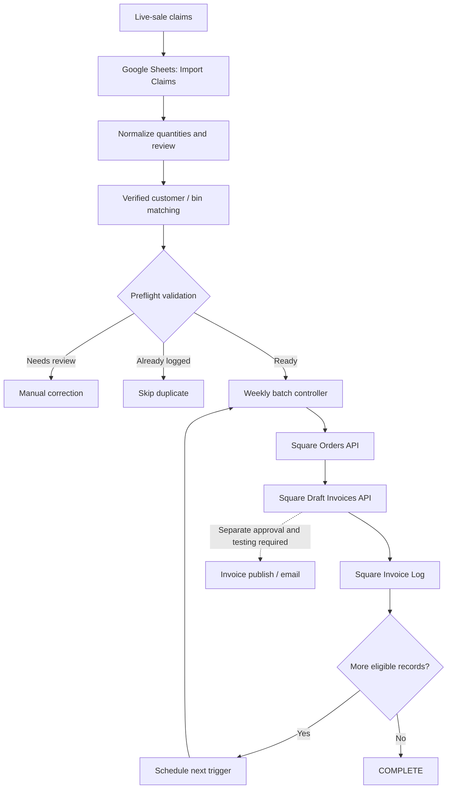

# Bee's Boutique Invoice Automation

**JavaScript · Google Apps Script · Google Sheets · Square REST API · JSON**

**Status:** In active production use for weekly draft-invoice processing | Square Sandbox testing completed | Bulk email publishing developed but not yet production-validated

## Overview

I developed a Google Sheets and Google Apps Script workflow to streamline weekly invoicing for **Bee's Boutique**, a retail business processing roughly 200 customer invoices in a busy week. The system organizes live-sale claims, verifies customer mappings, performs preflight checks, creates Square orders and **draft** invoices, and records processing results for review.

The system is now part of Bee's Boutique's ongoing weekly invoicing workflow. It replaces repetitive manual invoice preparation with a controlled, auditable process while reducing the risk of incorrect customer billing, duplicate orders, and lost work after an API failure.

### Production results

| Metric | Observed result |
|---|---:|
| Draft invoices created in a completed weekly cycle | **188** |
| Drafts created before automatic continuation was started | 52 |
| Drafts created by the automatic continuation workflow | **136** |
| Automatic continuation batches | **6** |
| Maximum invoices per creation batch | 25 |
| Final batch-controller status | **COMPLETE** |

These metrics document the first verified full production cycle. Bee's Boutique plans to continue using the draft-invoice automation as part of its regular weekly operations. The draft-creation workflow does **not** automatically publish or email invoices.

## The business problem

During live sales, customers claim products using assigned bin numbers. A bin may appear multiple times under the same product, indicating additional quantity, and the same bin can appear under different products. The business needs to aggregate claims correctly, match bins to verified Square customers, and create accurate invoices without processing the same customer twice.

Manually reconciling hundreds of line items and creating individual invoices was time-consuming and exposed the workflow to data-entry and duplicate-billing errors.

## How it works

1. **Import claims:** Load product, price, bin, quantity, week, and live-date records into Google Sheets.
2. **Normalize quantities:** Add repeated claims for the **same product and bin**; retain separate lines for different products.
3. **Review records:** Check claim status, totals, identifiers, and entries requiring attention.
4. **Match customers:** Use verified Square customer IDs linked to the appropriate bins.
5. **Run preflight validation:** Classify records as **Ready**, **Already Logged**, or **Needs Review**.
6. **Create drafts:** Create Square orders and draft invoices in batches of up to **25**.
7. **Record results:** Store invoice/order identifiers, status, and processing information in a dedicated invoice log.
8. **Continue automatically:** A time-driven trigger starts the next batch while eligible records remain.
9. **Complete or stop safely:** Mark the run **COMPLETE** when no eligible invoices remain, or stop for reconciliation when an error or unfinished transaction is detected.
10. **Send separately:** Publishing/emailing is a distinct, manually approved workflow; its production rollout is **not yet complete**.

## System architecture

## Features and technical implementation

### 1. Controlled batch processing

- Limits invoice creation to **25 customers per execution**.
- Uses Google Apps Script time-driven triggers for continuation.
- Persists the week, created count, batch count, and controller state in **Script Properties**.
- Uses the states `RUNNING`, `PROCESSING`, `COMPLETE`, and `STOPPED` to monitor progress.
- Checks the invoice log again before subsequent work rather than assuming earlier results.

### 2. Duplicate prevention and transaction safety

- Checks the **billing week + Square customer ID** against previously logged activity.
- Uses Square API **idempotency keys** to reduce duplicate operations.
- Records intermediate states such as `RESERVED` and `ORDER_CREATED` so uncertain outcomes can be reconciled.
- Blocks continued batch processing when unfinished invoice-log entries require investigation.
- Uses Apps Script locking to limit overlapping operations.

These controls **reduce risk**, but cannot guarantee exactly-once processing during every possible network or API failure; manual reconciliation remains important.

### 3. Preflight validation

| Classification | Meaning |
|---|---|
| **Ready** | Eligible for draft creation |
| **Already Logged** | Previously recorded for the billing week; excluded from new creation |
| **Needs Review** | Missing, inconsistent, or unverified information requires attention |

The workflow verifies customer mappings and checks the existing invoice log before creating financial records.

### 4. Invoice logging and monitoring

The Google Sheets **Square Invoice Log** supports tracking of billing week, customer/bin association, Square order and invoice IDs, status, timestamps, notes, and reconciliation information. Apps Script execution logs provide additional visibility into API failures, batch counts, and completion.

### 5. Draft-first financial workflow

Automatic creation produces **draft invoices only**. A separate function, `beeSendAllWeeklyInvoices`, was developed to preview, update due dates, and publish email-delivered invoices in bounded batches, but **bulk sending has not been fully validated in production** and is not part of the automatic draft-creation run.

## Technology stack

| Technology | How I used it |
|---|---|
| **JavaScript** | Data transformations, validation, control flow, error handling |
| **Google Apps Script** | Spreadsheet menus, time-driven triggers, locks, Script Properties, API calls |
| **Google Sheets** | Claims intake, review, customer mappings, formulas, invoice audit trail |
| **Square REST API** | Customer lookup, order creation, draft invoice management |
| **REST / JSON** | HTTP methods, request payloads, API responses, state serialization |
| **GitHub** | Technical documentation and iterative project history |

## Testing and validation

### Square Sandbox tests

Before production deployment, the workflow was tested with **30 simulated customers**, each assigned a unique bin and Square Sandbox customer ID.

| Sandbox check | Result |
|---|---|
| First invoice batch | 25 draft invoices |
| Second invoice batch | 5 draft invoices |
| Total new test drafts | **30** |
| Invoice log | All 30 recorded as `DRAFT` |
| Final preflight | 0 ready; 36 already logged (including 6 earlier test records); 0 needs review |
| Customer email publishing | Not performed |

The sandbox tests validated API integration, bounded batch processing, logging, and duplicate recognition. These figures are historical test results and are separate from the production run below.

### Production deployment

After troubleshooting and controlled manual runs, the production system created **188 draft invoices** for one weekly cycle. Of these, **52** were created before enabling automatic continuation, and **136** were created across **six automatically scheduled batches**. The controller ultimately reported `COMPLETE`.

The draft-invoice workflow is deployed and intended for continued weekly operational use, with ongoing maintenance and incremental improvements. The separate bulk email/publish workflow is **not yet production-validated**.

## Problems I investigated and resolved

**Square invoice API validation:** Corrected an unsupported `accepted_payment_methods.square_ach` field that caused invoice creation requests to fail.

**Due-date constraints:** Diagnosed Square's rejection when an invoice due date preceded its scheduled date; corrected the date for the tested production cycle. **Dynamic Friday date calculation remains planned.**

**Partial transaction recovery:** Recovered a case where a Square order existed but invoice creation failed, avoiding a blind duplicate-order retry.

**Multi-execution automation:** Implemented trigger-based continuation and persistent state to process a full weekly workload without manually starting each batch.

**Google Sheets date types:** Resolved an import failure caused by a Week ID interpreted as a date instead of the required `YYYY-MM-DD` text value.

**Quantity normalization:** Combined repeated claims for the same bin and product while preserving distinct product lines and explicit `x 2`, `x 3`, etc. quantities.

## Representative Apps Script functions

| Function | Responsibility |
|---|---|
| `importClaims` | Import claims into the workflow |
| `preflightMainWeeklyInvoices` | Evaluate weekly invoice readiness |
| `beeProductionVerifiedInvoicePreflight` | Apply production customer-verification checks |
| `createWeeklyDraftInvoices` | Create one bounded batch of Square drafts |
| `beeCreateAllWeeklyDrafts` | Start the weekly controller from a Google Sheets menu |
| `beeContinueWeeklyDrafts` | Process and schedule subsequent batches |
| `beeWeeklyBatchStatus` | Inspect the controller's persisted state |
| `beePreviewWeeklyInvoiceEmails` | Preview potential publish/email candidates without sending |
| `beeSendAllWeeklyInvoices` | Separate bulk publish/email function; further testing required |

## Security and operational safeguards

- Separate Square **Sandbox** and **production** environments.
- Production verification and explicit confirmation before creating real financial records.
- Restricted API credentials stored in Apps Script properties rather than committed to GitHub.
- Draft-only automatic creation; customer-facing sending is separate.
- Validation of customer identities and invoice eligibility.
- Locks, idempotency keys, status logging, and stop-on-error behavior.
- No customer names, email addresses, Square IDs, access tokens, or production transaction exports in this public portfolio package.

## Skills demonstrated

**IT / systems administration:** Business process automation, scheduled jobs, operational monitoring, troubleshooting, incident recovery, and documentation.

**Programming / integration:** JavaScript, REST APIs, JSON, HTTP request debugging, validation, exception handling, and stateful batch orchestration.

**Data integrity / security mindset:** Least-exposure documentation, secret handling, duplicate-prevention controls, audit logs, and risk-aware approval gates for financial actions.

**Professional practice:** Translating business requirements into technical workflows, sandbox testing, incremental production rollout, and communicating results through clear technical documentation.

## Google Sheets components

| Sheet | Purpose |
|---|---|
| `Import Claims` | Staging area for incoming claims |
| `Live Claims` | Active purchase records |
| `Weekly Bins` | Bin-to-customer mapping and verification |
| `Square Invoice Log` | Invoice status, identifiers, processing history, and review notes |

## Project structure

Bee-s-Boutique-Order-Invoice-Automation/
├── README.md
└── WORKFLOW.md

**Source code note:** This public portfolio package documents the architecture and verified results; it does **not** include an export of the full private production Apps Script. It is not a ready-to-deploy application.

## Ongoing operations and maintenance

Bee's Boutique will continue using this system for weekly claim processing and draft invoice creation. Ongoing responsibilities include reviewing preflight exceptions, reconciling invoice logs with Square, monitoring scheduled executions, and maintaining the integration as business needs change. Production improvements will be tested before release, particularly changes that affect customer billing or invoice delivery.

## Roadmap

- [x] Build claim intake and customer matching workflow
- [x] Integrate Square customer, order, and draft invoice APIs
- [x] Implement preflight checks, invoice logging, and duplicate safeguards
- [x] Validate 30-customer batch processing in Sandbox
- [x] Complete a full production draft-invoice cycle
- [x] Automate continuation across multiple batches
- [ ] Calculate each week's due date dynamically
- [ ] Fully test and approve the separate bulk publish/email workflow
- [ ] Add a safe Google Sheets action for sending approved invoices
- [ ] Strengthen reconciliation and automated tests with synthetic data
- [ ] Add sanitized screenshots or sample code to demonstrate implementation

## What I learned

This project gave me hands-on experience turning a real business bottleneck into a working technical system. I learned to debug external API errors, design safer retries around partially completed financial transactions, build reliable multi-run automations, and validate results in both test and production environments. These are transferable skills for **IT support, systems administration, cloud operations, and security-focused technical roles**.
